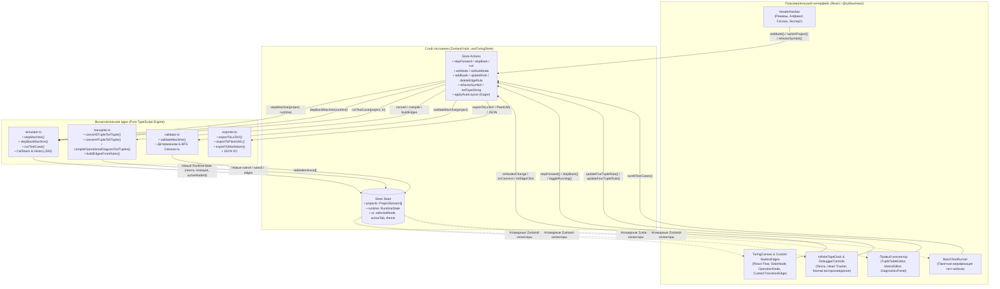
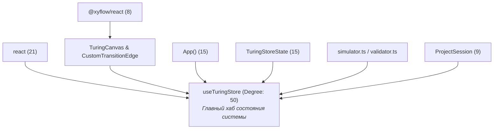

# Мастер-карта архитектуры проекта Turing Machine IDE & Diagrammer (`PROJECT_MAP.md`)

> **Next-Gen Turing Machine IDE & Diagrammer** — интерактивная веб-среда (SPA) для моделирования, симуляции, визуализации и верификации классических машин Тьюринга и операционных схем Поста-Тьюринга (VTM).  
> **Версия:** `1.0.0` | **Стек:** `React 18`, `TypeScript`, `@xyflow/react (v12)`, `Zustand 5`, `Tailwind CSS`, `Dagre`, `html-to-image`.

---

## Содержание

1. [Обзор и назначение проекта](#1-обзор-и-назначение-проекта)
2. [Глобальная архитектура и потоки данных](#2-глобальная-архитектура-и-потоки-данных)
3. [Карта каталогов и исходных файлов](#3-карта-каталогов-и-исходных-файлов)
4. [Детальный справочник по подсистемам](#4-детальный-справочник-по-подсистемам)
   - [4.1 Вычислительное ядро (`src/engine/`)](#41-вычислительное-ядро-srcengine)
   - [4.2 Модель данных и хранилище состояния (`src/store/`, `src/types/`)](#42-модель-данных-и-хранилище-состояния-srcstore-srctypes)
   - [4.3 Пользовательский интерфейс и компоненты (`src/components/`)](#43-пользовательский-интерфейс-и-компоненты-srccomponents)
5. [Основные пользовательские и системные сценарии (Workflow Guide)](#5-основные-пользовательские-и-системные-сценарии-workflow-guide)
6. [Архитектурный граф знаний Graphify](#6-архитектурный-граф-знаний-graphify)
7. [Руководство по расширению проекта (Extensibility Guide)](#7-руководство-по-расширению-проекта-extensibility-guide)

---

## 1. Обзор и назначение проекта

**Turing Machine IDE & Diagrammer** решает задачу глубокого визуального моделирования и формальной проверки дискретных вычислительных процессов. Приложение спроектировано как в помощь студентам и преподавателям курсов теории автоматов и формальных языков, так и для исследователей алгоритмов.

### Ключевые возможности:
- **Два фундаментальных математических режима**:
  1. **5-кортежи (5-tuples)**: Классическая модель Тьюринга $(q, a \to a', d, q')$, где $d \in \{L, R, N\}$. За один шаг каретка одновременно перезаписывает ячейку и смещается.
  2. **4-кортежи (4-tuples / Post-Turing)**: Модель Поста $(q, a \to C, q')$, где команда $C$ разделена: либо сдвиг головки ($L, R, N$), либо запись символа.
     - *State Graph*: стандартный ориентированный граф состояний.
     - *Operational Diagram (VTM)*: визуальная операционная блок-схема (узлы `START`, `FINISH`, сдвиги `l`/`r`, поиск до пустого `L`/`R`, запись `[a]`, вложенные подмашины) с условными переходами по символам (`a`, `*`, `¬a`).
- **Двусторонний транспилятор**: Автоматическая редукция $5\text{-tuple} \leftrightarrow 4\text{-tuple}$ с синтезом промежуточных состояний $q_{\text{aux}}$, а также компиляция схем VTM в детерминированные 4-кортежи.
- **Интерактивный CAD-интерфейс**: Бесконечный холст на `@xyflow/react` с поддержкой петель, нормального смещения встречных дуг, автоматической укладки Sugiyama (Dagre) и двусторонней связкой с таблицами и матрицей переходов.
- **Бесконечная разреженная лента и пошаговый отладчик**: Модель $\mathbb{Z}$-индексированной ленты, циклическая история снимков (глубина 500) для пошагового отката назад (**Step Back**), запуск настраиваемой скорости и расчет алгоритмической сложности (число тактов, число задействованных ячеек).
- **Статический анализатор и верификатор**: Проверка детерминизма, достижимости состояний (BFS), изолированных циклов, полноты функции переходов и корректности алфавитов.
- **Академический экспорт**: Выгрузка формулы машины $M = \langle Q, \Sigma, \Gamma, \delta, q_0, B, F \rangle$ и таблиц в LaTeX, диаграмм в PlantUML, спецификаций в Markdown, дампов в JSON и графических снимков в PNG/SVG.

---

## 2. Глобальная архитектура и потоки данных

Архитектура построена по принципу **однонаправленного потока данных (Unidirectional Data Flow)** с центральным реактивным хранилищем Zustand и полностью изолированным от UI вычислительным ядром.



---

## 3. Карта каталогов и исходных файлов

```
.
├── src/
│   ├── main.tsx                         # Точка входа React (ReactDOM.createRoot, Tailwind)
│   ├── App.tsx                          # Главный макет (Navbar, Canvas, Inspector, TapeDock)
│   ├── index.css                        # Базовые стили и директивы Tailwind CSS
│   ├── types/
│   │   └── turing.ts                    # Математическая и структурная модель типов TypeScript
│   ├── engine/                          # Изолированное вычислительное ядро (без зависимостей от React)
│   │   ├── simulator.ts                 # Симулятор тактов, лента SparseTape, стек вызовов, Undo-история
│   │   ├── validator.ts                 # Статический анализатор (детерминизм, BFS-достижимость, алфавит)
│   │   ├── transpiler.ts                # Редукции 5-tuple <-> 4-tuple и компилятор VTM-диаграмм
│   │   ├── exporter.ts                  # Экспортеры: LaTeX (семерка МТ), PlantUML, Markdown, JSON
│   │   └── engine.test.ts               # Интеграционный тест-сьют ядра (16 блоков проверок)
│   ├── store/
│   │   ├── useTuringStore.ts            # Центральный Zustand Store (сессии, мутации, отладчик, автолейаут)
│   │   └── demoProjects.ts              # 3 предустановленных эталонных проекта (5-tuple, 4-tuple, VTM)
│   ├── components/
│   │   ├── canvas/                      # Графический редактор на @xyflow/react
│   │   │   ├── TuringCanvas.tsx         # Холст, тулбар добавления узлов, интеграция с Dagre
│   │   │   ├── StateNode.tsx            # Узел классических состояний Q (Initial, Halt, Accept, Reject)
│   │   │   ├── OperationNode.tsx        # Операционный узел VTM (l, r, L, R, [a], complex, finish)
│   │   │   ├── CustomTransitionEdge.tsx # Дуга переходов (петли, встречные смещения, шильдики правил)
│   │   │   ├── NodeInspector.tsx        # Плавающее контекстное меню свойств узла
│   │   │   └── RuleModal.tsx            # Модальное окно редактирования условий переходов
│   │   ├── tape/                        # Лента и средства отладки
│   │   │   ├── InfiniteTapeDock.tsx     # Интерактивная лента (окно 25 ячеек, каретка, строковый ввод)
│   │   │   ├── DebuggerControls.tsx     # Управление шагами, воспроизведением, скоростью и счетчиками
│   │   │   └── BatchTestRunner.tsx      # Пакетный прогон тестовых наборов
│   │   ├── inspector/                   # Вкладки правого инспектора
│   │   │   ├── TupleTableEditor.tsx     # Табличный редактор четверок/пятерок с активной подсветкой
│   │   │   ├── MatrixEditor.tsx         # Матрица переходов Символы × Состояния с детекцией недетерминизма
│   │   │   └── DiagnosticsPanel.tsx     # Панель статических предупреждений и ошибок
│   │   ├── sidebar/                     # Выдвижные панели
│   │   │   ├── AlphabetBuilder.tsx      # Конструктор алфавита с пресетами и живым рефакторингом
│   │   │   └── SessionManagerDrawer.tsx # Менеджер сессий и проектов (создание, клонирование, удаление)
│   │   └── navbar/                      # Навигация и диалоги
│   │       ├── HeaderNavbar.tsx         # Шапка с переключателями режимов и триггерами диалогов
│   │       └── ExportModal.tsx          # Модальное окно экспорта в академические и графические форматы
│   └── utils/
│       └── exportImage.ts               # Утилита экспорта графа в PNG/SVG через html-to-image
├── docs/                                # Специализированные карты модулей от аналитиков
│   ├── MAP_ENGINE.md                    # Анализ вычислительного ядра (engine-analyst)
│   ├── MAP_STATE_AND_TYPES.md           # Анализ состояния и типов (state-analyst)
│   ├── MAP_COMPONENTS.md                # Анализ компонентов и UI (ui-analyst)
│   └── MAP_GRAPHIFY.md                  # Архитектурный граф знаний (graphify-builder)
├── graphify-out/                        # Артефакты графа знаний
│   ├── graph.html                       # Интерактивная веб-визуализация графа зависимостей
│   ├── graph.json                       # Машинночитаемый граф знаний
│   └── GRAPH_REPORT.md                  # Отчет по метрикам и сообществам графа
├── package.json                         # Зависимости и скрипты проекта
├── tsconfig.json                        # Конфигурация компилятора TypeScript
└── README.md                            # Вводное описание проекта
```

---

## 4. Детальный справочник по подсистемам

### 4.1 Вычислительное ядро (`src/engine/`)

Вычислительное ядро полностью изолировано от веб-окружения и DOM-структур. Все операции представляют собой чистые функции (Pure Functions), принимающие неизменяемое состояние и возвращающие новый слепок вычислений.

| Файл | Ключевые функции | Описание ответственности |
| :--- | :--- | :--- |
| [`simulator.ts`](file:///home/dranik/Projects/laba/nojstd8/src/engine/simulator.ts) | `initRuntimeState`<br/>`stepMachine`<br/>`stepBackMachine`<br/>`runTestCase` | **Исполнительный движок**. Управляет разреженной лентой `SparseTape: Record<number, string>`, положением каретки, счетчиком тактов, списком посещенных ячеек `visitedPositions`, стеком вызовов подмашин `CallStackFrame[]` и кольцевой историей `history: ExecutionSnapshot[]` (до 500 шагов). |
| [`validator.ts`](file:///home/dranik/Projects/laba/nojstd8/src/engine/validator.ts) | `validateMachine` | **Статический анализатор**. Проверяет алфавит (зарезервированные символы `L`, `R`, `N`), наличие и единственность начального узла (`START` / `initial`), наличие останова, детерминированность (отсутствие дублирующихся правил для одной пары $q, a$), связность и BFS-достижимость узлов (выявление изолированных компонент и циклов). |
| [`transpiler.ts`](file:///home/dranik/Projects/laba/nojstd8/src/engine/transpiler.ts) | `convert5TupleTo4Tuple`<br/>`convert4TupleTo5Tuple`<br/>`compileOperationalDiagramTo4Tuples`<br/>`buildEdgesFromRules` | **Транслятор и редуктор**. Выполняет взаимное отображение $5\text{-tuple} \leftrightarrow 4\text{-tuple}$ с расщеплением совмещенного шага через вспомогательные вершины $q_{\text{aux}}$. Компилирует визуальные операторы VTM (`SEARCH_L/R`, `SHIFT_L/R`, `WRITE_SYM`) в плоскую систему четверок Поста. Группирует правила в мульти-ребра графа. |
| [`exporter.ts`](file:///home/dranik/Projects/laba/nojstd8/src/engine/exporter.ts) | `exportProjectToJSON`<br/>`importProjectFromJSON`<br/>`exportToLaTeX`<br/>`exportToPlantUML`<br/>`exportToMarkdown`<br/>`escapeLatex` | **Форматный экспорт**. Генерирует формальное математическое описание семерки $M = \langle Q, \Sigma, \Gamma, \delta, q_0, B, F \rangle$ в LaTeX с таблицами, диаграммы для PlantUML, Markdown-таблицы и сериализацию в JSON. |
| [`engine.test.ts`](file:///home/dranik/Projects/laba/nojstd8/src/engine/engine.test.ts) | 16 блоков тестов | **Тестовый сьют**. Проверяет эталонные алгоритмы, обратимость транспиляции, работу стека подмашин, BFS-валидацию циклов, экранирование символов и интеграцию с операциями Zustand. |

---

### 4.2 Модель данных и хранилище состояния (`src/store/`, `src/types/`)

#### Модель данных ([`src/types/turing.ts`](file:///home/dranik/Projects/laba/nojstd8/src/types/turing.ts))
- **`ProjectSession`**: Главная структура документа, содержащая идентификатор, имя, описание, режим (`5-tuple` / `4-tuple`), подрежим (`state-graph` / `operational`), алфавит `AlphabetConfig`, массивы узлов `TuringNode[]` и ребер `TuringEdge[]`, массивы правил `FiveTupleRule[]` и `FourTupleRule[]`, подмашины `SubMachine[]`, начальную ленту `initialTape` и тестовые наборы `TestCase[]`.
- **`FiveTupleRule`**: Кортеж $(q_i, a \to a', D, q_j)$ с параметрами `fromState`, `readSymbol`, `writeSymbol`, `move: 'L'|'R'|'N'`, `toState`.
- **`FourTupleRule`**: Кортеж $(q_i, a \to C, q_j)$ с параметрами `fromState`, `readSymbol`, `command: string`, `toState`.
- **`RuntimeState`**: Оперативный контекст симуляции: `currentNodeId`, `headPosition`, `tape: SparseTape`, `stepCount`, `visitedPositions`, `callStack`, `history`, `status: 'idle'|'running'|'paused'|'halted'|'error'`.

#### Центральное хранилище ([`src/store/useTuringStore.ts`](file:///home/dranik/Projects/laba/nojstd8/src/store/useTuringStore.ts))
Store построен на Zustand с middleware `persist` (сохранение в `localStorage` через адаптер `safeStorage` с fallback в память).
- **Синхронизация представлений**: При любом изменении правил переходов автоматически обновляется геометрия и шильдики ребер графа (`buildEdgesFromRules`), а при редактировании графа на холсте обновляются таблицы правил.
- **Каскадный рефакторинг (`refactorSymbol`)**: Сквозная атомарная замена символа алфавита сразу во всех сущностях (в алфавите, в правилах `rules5`/`rules4`, в узлах `WRITE_SYM`, на ленте `initialTape`, в тест-кейсах и во всех вложенных подмашинах).
- **Интеграция с Dagre (`applyAutoLayout`)**: Алгоритм Sugiyama рассчитывает координаты узлов со смещением слева направо (`rankdir: 'LR'`) с последующей плавной центровкой вьюпорта `fitView({ duration: 300 })`.

#### Эталонные демо-проекты ([`src/store/demoProjects.ts`](file:///home/dranik/Projects/laba/nojstd8/src/store/demoProjects.ts))
1. **`DEMO_PROJECT_1` (5-Tuple)**: Замена служебных маркеров `#` и `$` на нули с сохранением бит данных.
2. **`DEMO_PROJECT_2` (4-Tuple State-Graph)**: Инкремент двоичного числа с переносом разряда влево (`1011` $\to$ `1100`, `111` $\to$ `1000`). Демонстрирует строгое разделение фаз движения и записи в четвёрках Поста.
3. **`DEMO_PROJECT_3` (4-Tuple VTM Operational)**: Копирование слова через разделитель `#` с использованием функциональных блоков (`SHIFT_R`, `WRITE_SYM`, `SEARCH_R`, `SEARCH_L`).

---

### 4.3 Пользовательский интерфейс и компоненты (`src/components/`)

Интерфейс оформлен в строгом CAD/Linear-стиле с жестким ограничением вьюпорта (`100vw × 100vh`) без глобального скролла страницы.

#### Холст диаграмм (`src/components/canvas/`)
- **[`TuringCanvas.tsx`](file:///home/dranik/Projects/laba/nojstd8/src/components/canvas/TuringCanvas.tsx)**: Корневой контейнер `@xyflow/react` с провайдером `ReactFlowProvider`. Включает плавающий FAB-тулбар создания узлов, миникарту `MiniMap` и обработчики соединения вершин `onConnect`.
- **[`StateNode.tsx`](file:///home/dranik/Projects/laba/nojstd8/src/components/canvas/StateNode.tsx)**: Узел классических состояний $Q$. Поддерживает роли: `initial` (зеленый акцент), `normal`, `halt` (янтарный), `accept` (бирюзовый), `reject` (красный). Финальные состояния имеют двойную рамку. Четыре порта подключения (`top`, `right`, `bottom`, `left`).
- **[`OperationNode.tsx`](file:///home/dranik/Projects/laba/nojstd8/src/components/canvas/OperationNode.tsx)**: Функциональные блоки VTM: `START`, сдвиги `l` и `r`, поиск до бланка `L` и `R`, запись `[a]`, останов `FINISH` и вызов подмашины `COMPLEX_MACHINE`.
- **[`CustomTransitionEdge.tsx`](file:///home/dranik/Projects/laba/nojstd8/src/components/canvas/CustomTransitionEdge.tsx)**: Продвинутая отрисовка дуг:
  - Петли самоперехода (`source === target`) по кубической кривой Безье вверх над узлом.
  - Встречные дуги (`isBiDirectional`): автоматический ортогональный сдвиг на 36px по вектору нормали, исключающий наложение кривых.
  - Шильдики правил `EdgeLabelRenderer` с возможностью быстрого добавления/удаления условий перехода.
  - Анимированная подсветка активной дуги на текущем такте выполнения.
- **[`NodeInspector.tsx`](file:///home/dranik/Projects/laba/nojstd8/src/components/canvas/NodeInspector.tsx)**: Плавающий контекстный инспектор параметров выделенного узла.
- **[`RuleModal.tsx`](file:///home/dranik/Projects/laba/nojstd8/src/components/canvas/RuleModal.tsx)**: Центрированное диалоговое окно для создания или детальной настройки параметров перехода.

#### Модуль ленты и отладчика (`src/components/tape/`)
- **[`InfiniteTapeDock.tsx`](file:///home/dranik/Projects/laba/nojstd8/src/components/tape/InfiniteTapeDock.tsx)**: Нижний док с 25-ячеечной видимой полосой ленты, центрированной вокруг головки. Поддерживает быстрый строковый ввод слова, сохранение/сброс буфера начального состояния, кликабельное редактирование символов и индикацию посещенных ячеек.
- **[`DebuggerControls.tsx`](file:///home/dranik/Projects/laba/nojstd8/src/components/tape/DebuggerControls.tsx)**: Панель тактовой отладки. Кнопки `Step Forward`, `Step Back` (реверс по снимкам истории), `Run / Pause`, регулятор задержки такта (30–800 мс) и индикаторы телеметрии: `TICK` (число тактов), `CELLS` (число затронутых ячеек), `STACK` (глубина вложенных машин).
- **[`BatchTestRunner.tsx`](file:///home/dranik/Projects/laba/nojstd8/src/components/tape/BatchTestRunner.tsx)**: Пакетный верификатор набора входных и ожидаемых слов с расчетом времени выполнения и выгрузкой теста на основную ленту.

#### Инспекторы и редакторы (`src/components/inspector/`)
- **[`TupleTableEditor.tsx`](file:///home/dranik/Projects/laba/nojstd8/src/components/inspector/TupleTableEditor.tsx)**: Табличный редактор четверок или пятерок с инлайн-редактированием ячеек, быстрым добавлением правил и подсветкой активного кортежа в реальном времени.
- **[`MatrixEditor.tsx`](file:///home/dranik/Projects/laba/nojstd8/src/components/inspector/MatrixEditor.tsx)**: Матрица переходов $\Sigma \times Q$. Отображает детерминированные переходы, динамически подсвечивает недетерминированные конфликты с бейджами и раскрытием альтернатив.
- **[`DiagnosticsPanel.tsx`](file:///home/dranik/Projects/laba/nojstd8/src/components/inspector/DiagnosticsPanel.tsx)**: Отчет статического верификатора `validator.ts` в реальном времени с подсветкой ошибок (`error`), предупреждений (`warning`) и интерактивным переходом к проблемному узлу/ребру по клику.

#### Навигация и диалоги (`src/components/navbar/`, `src/components/sidebar/`)
- **[`HeaderNavbar.tsx`](file:///home/dranik/Projects/laba/nojstd8/src/components/navbar/HeaderNavbar.tsx)**: Верхняя полоса (48px) с переключением математических режимов (`5-Tuple`, `4-Tuple State-Graph`, `4-Tuple VTM`), переименованием проекта, переключением тем оформления и триггерами диалогов.
- **[`AlphabetBuilder.tsx`](file:///home/dranik/Projects/laba/nojstd8/src/components/sidebar/AlphabetBuilder.tsx)**: Выдвижной редактор алфавита с академическими пресетами (бинарный, унарный, десятичный, шестнадцатеричный, символьный), выбором маркера пустого символа (`λ`, `_`, `␣`, `a0`) и защитой от конфликтов со служебными символами.
- **[`SessionManagerDrawer.tsx`](file:///home/dranik/Projects/laba/nojstd8/src/components/sidebar/SessionManagerDrawer.tsx)**: Шторка управления сохраненными проектами, поиска, дублирования и импорта/экспорта файлов `.json`.
- **[`ExportModal.tsx`](file:///home/dranik/Projects/laba/nojstd8/src/components/navbar/ExportModal.tsx)**: Диалоговое окно академического и графического экспорта (LaTeX, PlantUML, Markdown, JSON, PNG, SVG).

---

## 5. Основные пользовательские и системные сценарии (Workflow Guide)

### Сценарий 1: Создание и конструирование алгоритма
1. Пользователь создает проект через `SessionManagerDrawer` или выбирает режим в `HeaderNavbar` (`5-Tuple`, `4-Tuple State-Graph` или `VTM`).
2. В `AlphabetBuilder` настраивается рабочий алфавит ленты (или применяется пресет, например, бинарный).
3. На холсте `TuringCanvas` создаются вершины с помощью FAB-панели (`+ Состояние`, `+ Halt` или операционные блоки VTM).
4. Перетаскиванием связей между портами вершин открывается `RuleModal`, где задается считываемый символ, записываемый символ и направление сдвига каретки.
5. Правила автоматически синхронизируются с `TupleTableEditor` и `MatrixEditor`.
6. Нажатие кнопки **Раскладка** на холсте упорядочивает граф по алгоритму Dagre.

### Сценарий 2: Пошаговая симуляция и отладка (Debugging)
1. В поле ввода ленты `InfiniteTapeDock` вводится начальное слово (например, `1011`) и нажимается Enter.
2. Кнопка **В буфер** сохраняет эту конфигурацию как исходную.
3. Пользователь нажимает **Шаг вперед** (`Space` или `→`):
   - Вызывается `simulator.ts: stepMachine()`.
   - В массив `runtime.history` сохраняется снимок текущего состояния.
   - Считывается символ под головкой, находится соответствующее правило в `rules5`/`rules4`.
   - Производится запись на ленту, сдвиг головки и переход в целевое состояние.
   - На холсте подсвечивается активный узел и сработавшее ребро, на ленте перемещается треугольный указатель каретки, в инспекторе подсвечивается строка таблицы.
4. При необходимости отката назад пользователь нажимает **Шаг назад** (`Shift+Space` или `←`):
   - Вызывается `simulator.ts: stepBackMachine()`.
   - Извлекается последний снимок из `history` и мгновенно восстанавливается лента, положение головки и активный узел.
5. Нажатие `R` включает непрерывное воспроизведение симуляции с регулируемой скоростью.

### Сценарий 3: Верификация и диагностика
1. Во вкладке **Check** инспектора отображаются результаты `validator.ts: validateMachine()`.
2. Если в графе есть недетерминированные переходы (одинаковый символ чтения из одного состояния) или отсутствует начальный узел, отображаются карточки ошибок.
3. Клик по карточке ошибки центрирует холст на проблемном узле или ребре.

### Сценарий 4: Пакетное тестирование (Batch Testing)
1. Во вкладке **Тесты** инспектора (`BatchTestRunner`) пользователь добавляет тест-кейсы: входное слово, ожидаемое слово на ленте и ожидаемый останов.
2. Нажатие **Запустить все тесты** выполняет изолированные прогоны `runTestCase()` без замедления рендером.
3. Отображаются зеленые/красные индикаторы успеха, затраченное число тактов и фактический результат.
4. Кнопка загрузки позволяет перенести любой тест на основную ленту для детального пошагового разбора.

### Сценарий 5: Академический отчет и экспорт
1. Нажатие кнопки **Экспорт** в шапке открывает `ExportModal`.
2. Пользователь выбирает вкладку **LaTeX**:
   - Генерируется математическое описание семерки автомата $M = \langle Q, \Sigma, \Gamma, \delta, q_0, B, F \rangle$ и таблица переходов в среде `tabular`.
   - Кнопка **Скопировать** переносит готовый LaTeX-код в буфер обмена для курсовой или лабораторной работы.
3. Вкладка **Снимок** позволяет скачать PNG или SVG схему графа с прозрачным или контрастным фоном.

---

## 6. Архитектурный граф знаний Graphify

Проект полностью проанализирован и оцифрован с помощью инструмента статического анализа и кластеризации `graphify`.

### 6.1 Интерактивный граф
Интерактивная карта знаний доступна в браузере по адресу:  
[`graphify-out/graph.html`](file:///home/dranik/Projects/laba/nojstd8/graphify-out/graph.html)  
Машинночитаемый граф сущностей: [`graphify-out/graph.json`](file:///home/dranik/Projects/laba/nojstd8/graphify-out/graph.json)  
Аналитический отчет: [`graphify-out/GRAPH_REPORT.md`](file:///home/dranik/Projects/laba/nojstd8/graphify-out/GRAPH_REPORT.md)

### 6.2 Метрики графа
- **Всего узлов (Nodes):** 301 (файлы, типы, компоненты, функции, спецификации).
- **Всего связей (Edges):** 604 (вызовы функций, импорты, зависимости, композиция).
- **Сообществ модульности (Communities):** 12 кластеров.
- **Циклических зависимостей (Import Cycles):** **0** (проект полностью ацикличен).
- **Качество извлечения:** 100% Extracted (детерминированное извлечение из AST).

### 6.3 Архитектурные ядра ("God Nodes" системы)



| Ранг | Узел | Степень связности (Degree) | Расположение | Архитектурная роль |
| :---: | :--- | :---: | :--- | :--- |
| **1** | `useTuringStore` | **50** | `src/store/useTuringStore.ts` | **Центральный координатор.** Связывает воедино UI-компоненты, математическое ядро, ленту и историю. |
| **2** | `react` | **21** | Зависимость npm | Среда выполнения интерфейса. |
| **3** | `lucide-react` | **19** | Зависимость npm | Векторная графика и пиктограммы интерфейса. |
| **4** | `compilerOptions` | **16** | `tsconfig.json` | Корневая строгая конфигурация компилятора TypeScript. |
| **5** | `App()` | **15** | `src/App.tsx` | Корневая раскладка рабочего пространства и глобальные горячие клавиши. |
| **6** | `TuringStoreState` | **15** | `src/store/useTuringStore.ts` | Полный интерфейс состояния и сигнатур всех экшенов. |
| **7** | `5.2 Manual Testing Script` | **14** | `CHECKLIST_ROADMAP.md` | Спецификация критериев приемки и ручных сценариев. |
| **8** | `ProjectSession` | **9** | `src/types/turing.ts` | Каноническая модель документа сессии машины Тьюринга. |
| **9** | `@xyflow/react` | **8** | Зависимость npm | Ядро векторного холста узлов и ребер. |
| **10** | `ExportModal()` | **8** | `src/components/navbar/ExportModal.tsx` | Модуль форматированного вывода и экспорта. |

### 6.4 Ключевые функциональные сообщества
1. **Engine Execution & Simulation (Cluster 1)**: `simulator.ts`, `validator.ts`, `transpiler.ts`, `exporter.ts`. Чистое функциональное ядро без обратных зависимостей от React.
2. **UI Shell & Canvas (Cluster 3, 5)**: `TuringCanvas.tsx`, `CustomTransitionEdge.tsx`, `StateNode.tsx`, `OperationNode.tsx`, `TupleTableEditor.tsx`, `MatrixEditor.tsx`.
3. **Unit Tests & Engine Suite (Cluster 0)**: Сьют интеграционных тестов `engine.test.ts` (16 блоков проверок).
4. **Predefined Algorithms (Cluster 9)**: `demoProjects.ts` с эталонными конфигурациями 5-tuple, 4-tuple и VTM.

---

## 7. Руководство по расширению проекта (Extensibility Guide)

### 7.1 Как добавить новый тип узла в операционную диаграмму VTM
1. **Расширить объединение типов** в [`src/types/turing.ts`](file:///home/dranik/Projects/laba/nojstd8/src/types/turing.ts):
   Добавить новый литерал в `OperationalNodeType` (например, `INVERT_CELL`):
   ```typescript
   export type OperationalNodeType =
     | 'START' | 'FINISH' | 'SHIFT_L' | 'SHIFT_R' | 'SEARCH_L' | 'SEARCH_R'
     | 'WRITE_SYM' | 'COMPLEX_MACHINE' | 'INVERT_CELL';
   ```
2. **Добавить исполнение в симулятор** в [`src/engine/simulator.ts`](file:///home/dranik/Projects/laba/nojstd8/src/engine/simulator.ts):
   В функции `stepMachine()` в секции обработки `operational` узлов добавить ветку:
   ```typescript
   } else if (opData.opType === 'INVERT_CELL') {
     const current = newTape[newHead] ?? blank;
     newTape[newHead] = current === '0' ? '1' : (current === '1' ? '0' : current);
   }
   ```
3. **Добавить правило компиляции в 4-кортежи** в [`src/engine/transpiler.ts`](file:///home/dranik/Projects/laba/nojstd8/src/engine/transpiler.ts):
   В функции `compileOperationalDiagramTo4Tuples()` описать раскрытие операции в соответствующие команды четверок.
4. **Зарегистрировать отображение узла в UI**:
   - В [`src/components/canvas/OperationNode.tsx`](file:///home/dranik/Projects/laba/nojstd8/src/components/canvas/OperationNode.tsx) добавить иконку, текстовый бейдж (например, `~`) и цветовую схему.
   - В [`src/components/canvas/TuringCanvas.tsx`](file:///home/dranik/Projects/laba/nojstd8/src/components/canvas/TuringCanvas.tsx) добавить кнопку создания узла в плавающий тулбар:
     ```tsx
     <button onClick={() => addOperationNode('INVERT_CELL', 'Инверсия')} ...>
     ```
5. **Добавить юнит-тест** в [`src/engine/engine.test.ts`](file:///home/dranik/Projects/laba/nojstd8/src/engine/engine.test.ts).

### 7.2 Как добавить новое правило статической валидации
1. В [`src/engine/validator.ts`](file:///home/dranik/Projects/laba/nojstd8/src/engine/validator.ts) добавить условие проверки в функцию `validateMachine(session)`:
   ```typescript
   // Пример: предупреждение о слишком длинном слове начальной ленты
   const nonBlankCount = Object.keys(session.initialTape).length;
   if (nonBlankCount > 1000) {
     issues.push({
       id: 'tape_too_large',
       severity: 'warning',
       message: 'Начальная лента содержит более 1000 ячеек, симуляция может быть замедлена.',
     });
   }
   ```
2. Убедиться, что `severity` выставлен корректно:
   - `'error'` — блокирует корректное выполнение машины.
   - `'warning'` — потенциальная проблема логики или производительности.
   - `'info'` — рекомендация по оформлению алгоритма.
3. Сообщение мгновенно отобразится во вкладке **Check** инспектора (`DiagnosticsPanel.tsx`).

### 7.3 Как добавить новый формат экспорта
1. В [`src/engine/exporter.ts`](file:///home/dranik/Projects/laba/nojstd8/src/engine/exporter.ts) создать чистую функцию-генератор:
   ```typescript
   export function exportToCSV(project: ProjectSession): string {
     const headers = project.mode === '5-tuple' 
       ? 'From,Read,Write,Move,To\n' 
       : 'From,Read,Command,To\n';
     // Генерация строк CSV...
     return headers + rows.join('\n');
   }
   ```
2. В [`src/components/navbar/ExportModal.tsx`](file:///home/dranik/Projects/laba/nojstd8/src/components/navbar/ExportModal.tsx) добавить новую вкладку формата, окно предварительного просмотра с подсветкой и кнопку скачивания файла с расширением `.csv`.

### 7.4 Как добавить новый пресет алфавита
1. В [`src/store/useTuringStore.ts`](file:///home/dranik/Projects/laba/nojstd8/src/store/useTuringStore.ts) найти константу `ALPHABET_PRESETS` и добавить новую конфигурацию:
   ```typescript
   dna: {
     name: 'ДНК (A, C, G, T)',
     symbols: ['A', 'C', 'G', 'T'],
     blankSymbol: '_',
   },
   ```
2. Новый пресет автоматически отобразится в выпадающем списке конструктора `AlphabetBuilder.tsx`.

---

## 8. Сводка команд разработки и верификации

```bash
# Установка зависимостей
npm install

# Запуск локального сервера разработки (Vite HMR на http://localhost:5173)
npm run dev

# Запуск полного сьюта интеграционных тестов ядра (16 блоков)
npm test

# Статическая проверка типов TypeScript и сборка продакшен-бандла
npm run build

# Предпросмотр собранного продакшен-бандла
npm run preview
```

---
*Документ подготовлен агентом `@cartographer` на основе отчетов `@engine-analyst`, `@state-analyst`, `@ui-analyst` и `@graphify-builder`.*
