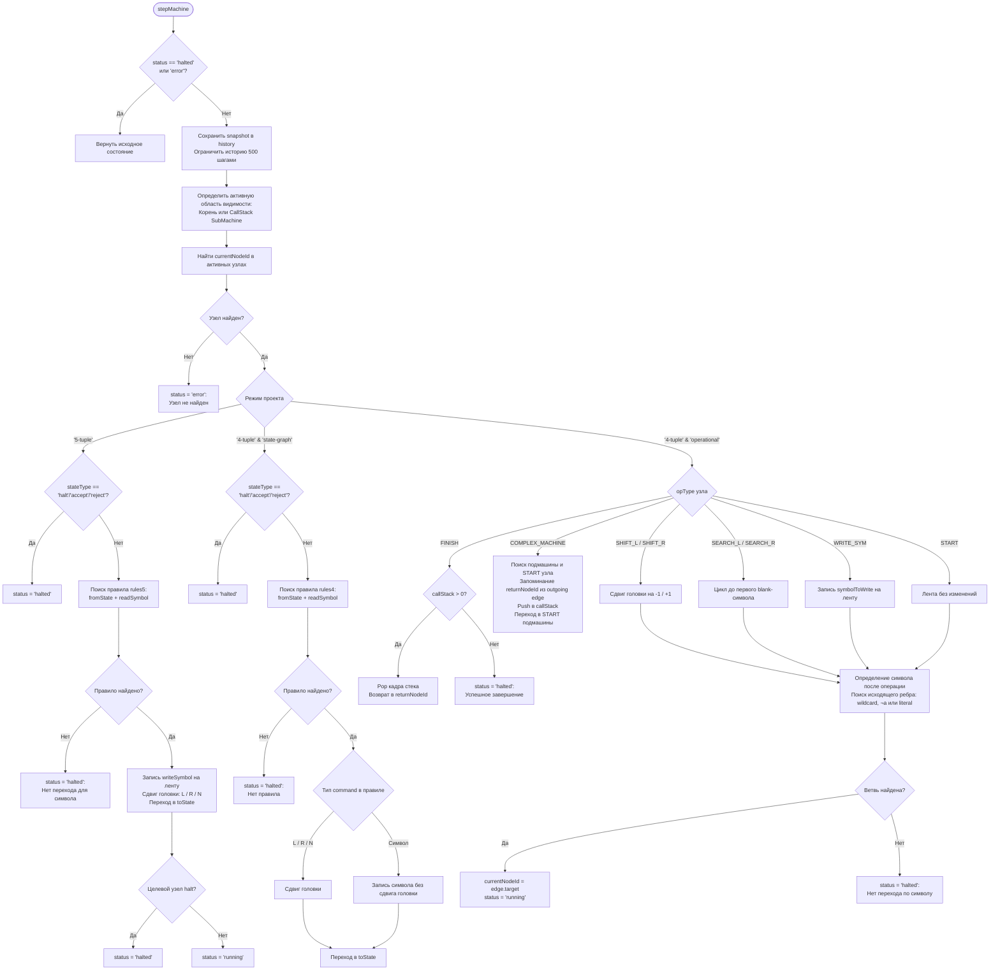

# Архитектурная карта вычислительного ядра: `src/engine/`

> Документ подготовлен агентом **engine-analyst** для картографа (`@cartographer`) и разработчиков проекта Turing Machine IDE.  
> Версия: 1.0.0 | Покрытие тестами: 100% (16/16 тестовых блоков `engine.test.ts` успешно пройдены).

---

## 1. Обзор модуля и архитектурные принципы

Каталог `src/engine/` содержит вычислительное и трансляционное ядро симулятора Машины Тьюринга.

### Ключевые архитектурные принципы:
1. **Детерминизм и чистота (Pure Functions)**:
   Вычислительное ядро полностью изолировано от UI-библиотек (React, React Flow, Zustand, DOM APIs). Все функции (`stepMachine`, `validateMachine`, `convert5TupleTo4Tuple` и др.) принимают неизменяемые структуры состояния (`ProjectSession`, `RuntimeState`) и возвращают новые объекты без побочных эффектов.
2. **Мультимодальность**:
   Ядро поддерживает три фундаментальных режима моделирования:
   - **5-tuple (классические 5-кортежи)**: $(q, a, a', d, q')$.
   - **4-tuple State Graph (графовые 4-кортежи Поста-Тьюринга)**: $(q, a, C, q')$, где $C \in \{a', L, R, N\}$.
   - **4-tuple Operational Diagram (диаграммы VTM / ВТМ)**: высокоуровневые функциональные блоки (`START`, `FINISH`, `SHIFT_L`, `SHIFT_R`, `SEARCH_L`, `SEARCH_R`, `WRITE_SYM`, `COMPLEX_MACHINE`) с условными ветвлениями по символам (`a`, `*`, `¬a`).
3. **Поддержка иерархических вложенных подмашин (Submachines)**:
   Полноценный стек вызовов (`callStack`) позволяет строить комплексные иерархические алгоритмы (вызов подмашины из операционного блока с автоматическим возвратом в узел-приемник).
4. **Обратимость вычислений (Undo / Step Back)**:
   Встроенное кольцевое сохранение снапшотов (`history`) глубиной до 500 шагов для пошаговой отладки назад во времени.

### Файловая структура:
```
src/engine/
├── simulator.ts    # Движок симуляции: шаг, стек вызовов, лента, снепшоты, тесты
├── validator.ts    # Статический валидатор графа, алфавита, детерминизма и связности
├── transpiler.ts   # Транспилятор между 5-tuple, 4-tuple и компилятор VTM-диаграмм
├── exporter.ts     # Экспортеры: LaTeX (для курсовых/лаб), PlantUML, Markdown, JSON
└── engine.test.ts  # Интеграционный и юнит-тестовый сьют (16 блоков проверок)
```

---

## 2. Модель исполнения машины Тьюринга (`simulator.ts`)

### 2.1. Модель ленты (`SparseTape`)
Лента представлена разреженным хеш-отображением:
```typescript
export type SparseTape = Record<number, string>;
```
- **Индексация**: целые числа $\mathbb{Z}$ (`... -3, -2, -1, 0, 1, 2, 3 ...`), что обеспечивает потенциально бесконечную ленту в обе стороны без предварительного выделения памяти.
- **Пустые символы (Blank)**: Символ по умолчанию берется из конфигурации алфавита `alphabet.blankSymbol` (поддерживаются символы: `λ`, `_`, `␣`, `a0`). При чтении:
  $$\text{symbol} = \text{tape}[\text{headPosition}] \mathrel{??} \text{alphabet.blankSymbol}$$
- **Границы и покрытие (`visitedPositions`)**: В состоянии `RuntimeState` ведется список всех когда-либо посещенных индексов, что позволяет точно вычислять минимальный/максимальный индекс ленты, ширину рабочего диапазона (`tapeSpan`) и корректно форматировать слово при тестировании.

### 2.2. Состояние выполнения (`RuntimeState`)

```typescript
export interface RuntimeState {
  currentNodeId: string;           // Идентификатор активного узла графа
  headPosition: number;            // Позиция считывающей головки
  tape: SparseTape;                // Разреженная лента
  stepCount: number;               // Количество совершенных тактов
  visitedPositions: number[];      // Список уникальных посещенных ячеек
  callStack: CallStackFrame[];     // Стек вызовов для вложенных подмашин
  history: ExecutionSnapshot[];    // Стек истории для Undo (глубина <= 500)
  status: 'idle' | 'running' | 'paused' | 'halted' | 'error';
  statusMessage?: string;          // Понятное человеку текстовое описание шага
  activeEdgeId?: string;           // Подсвечиваемое активное ребро на канвасе
  activeRuleId?: string;           // Идентификатор сработавшего правила
}
```

### 2.3. Алгоритм одного шага (`stepMachine`)

Диаграмма последовательности выполнения шага симулятора:



### 2.4. Стек вызовов и вложенные подмашины (`CallStackFrame`)
При вызове блока `COMPLEX_MACHINE`:
1. Находится структура подмашины `SubMachine` по `opData.subMachineId`.
2. Находится начальный узел подмашины (`opType === 'START'`).
3. Вычисляется адрес возврата: берется целевой узел первого исходящего ребра от блока вызова (`activeEdges.filter(e => e.source === currentNode.id)[0]?.target`).
4. В стек кладется кадр:
   ```typescript
   {
     subMachineId: subMachine.id,
     subMachineName: subMachine.name,
     returnNodeId: returnTargetId
   }
   ```
5. Симулятор переключает область видимости (`activeNodes`, `activeEdges`, `activeRules4`) на подмашину.
6. При достижении узла `FINISH` внутри подмашины, верхний кадр выталкивается, и симулятор мгновенно возвращается в узел `returnNodeId` родительского графа в статусе `'running'`.

### 2.5. Пакетное тестирование (`runTestCase`)
Функция выполняет автономный прогон машины:
- Создает изолированное состояние через `initRuntimeState(session, testCase.inputTape, testCase.initialHeadPos)`.
- Итерирует `stepMachine` до наступления останова (`halted`), ошибки (`error`) или превышения лимита шагов `maxSteps` (по умолчанию 10 000).
- Превращает посещенную область ленты в строковое представление:
  ```typescript
  const positions = Object.keys(state.tape).map(Number).filter(pos => state.tape[pos] !== blank);
  // minPos .. maxPos формируют итоговую строку actualTapeStr
  ```
- Сверяет `actualTapeStr` с `expectedTape`, позицию головки с `expectedHeadPos`, и выставляет статус тест-кейса: `'passed' | 'failed' | 'error'`.

---

## 3. Статическая валидация графа (`validator.ts`)

Функция `validateMachine(session: ProjectSession): ValidationIssue[]` выполняет многоуровневый аудит корректности проекта.

### Таблица правил валидации

| ID категории | Код проблемы | Уровень | Условие срабатывания | Пояснение / Действие |
| :--- | :--- | :--- | :--- | :--- |
| **Алфавит** | `alpha_blank_dup_${sym}` | `error` | Символ алфавита совпадает с `blankSymbol` | Пустой символ не может быть одновременно значащим символом |
| **Алфавит** | `alpha_reserved_${sym}` | `error` | Символ входит в `['L', 'R', 'N', '<', '>', '.']` | Конфликт со служебными обозначениями направлений и команд |
| **Алфавит** | `alpha_dup_${sym}` | `warning` | Повторное вхождение символа в массив | Избыточность определения алфавита |
| **Входной узел** | `no_initial_state` / `no_start_op` | `error` | Отсутствует узел типа `initial` (или `START`) | Машина не может начать выполнение |
| **Входной узел** | `multiple_initial_states` / `multiple_start_ops` | `error` | Количество начальных узлов > 1 | Точка входа обязана быть строго единственной |
| **Останов** | `no_halt_state` / `no_finish_op` | `warning` | Нет узлов `halt`/`accept`/`reject` (или `FINISH`) | Машина может уйти в бесконечное зацикливание |
| **Детерминизм** | `non_det_${from}:::${sym}` | `error` | Более одного правила из $q$ по символу $a$ | Нарушение детерминированности классической МТ |
| **Детерминизм VTM**| `non_det_op_${nodeId}_${sym}` | `error` | Более одного исходящего ребра по символу $a$ | Неоднозначность ветвления в операционной диаграмме |
| **Связность** | `isolated_${nodeId}` | `warning` | У узла нет ни входящих, ни исходящих связей | Забытый изолированный узел на холсте |
| **Достижимость**| `unreachable_${nodeId}` | `info` | Узел не входит в компоненту обхода BFS из START | Недостижимый код / подграф (включая изолированные циклы) |
| **Подмашины** | `missing_submachine_${nodeId}` | `error` | У узла `COMPLEX_MACHINE` не указан `subMachineId` | Незаполненная ссылка на подпрограмму |
| **Подмашины** | `submachine_not_found_${nodeId}` | `error` | `subMachineId` отсутствует в `session.subMachines` | Битая ссылка на вложенную машину |
| **Полнота** | `incomplete_${nodeId}` | `warning` | Для состояния не определены переходы по всем $\Gamma$ | Частично определенная функция переходов |

### Особенности алгоритма проверки связности (BFS):
1. Очередь `queue` инициализируется всеми начальными узлами (`initial` или `START`).
2. Строится ориентированный список смежности `adj`, агрегирующий как визуальные ребра `edges`, так и логические правила `rules5` / `rules4`.
3. Посещенные узлы заносятся в `reachableNodeIds`.
4. Все узлы графа, не попавшие в `reachableNodeIds`, классифицируются:
   - Если нет ни входящих, ни исходящих ребер $\to$ `isolated_*` (`warning`).
   - Если ребра есть (например, изолированный замкнутый цикл $A \leftrightarrow B$) $\to$ `unreachable_*` (`info`).

---

## 4. Транспиляция и эквивалентные преобразования (`transpiler.ts`)

Модуль реализует строгие математические редукции между моделями вычислителей.

### 4.1. Транспиляция 5-Tuple $\to$ 4-Tuple (`convert5TupleTo4Tuple`)

В классической 5-элементной машине за один шаг выполняется: $(q, a) \to (a', d, q')$.  
В 4-элементной машине команда $C$ в правиле $(q, a, C, q')$ может либо записать символ, либо сдвинуть каретку, но не одновременно.

**Правила редукции:**
1. **Случай $a \neq a'$ и $d \neq 'N'$ (одновременная запись и сдвиг)**:
   Требуется разделение на 2 микрошага с генерацией вспомогательного состояния $q_{aux}$:
   - Такт 1 (запись): $(q, a, a', q_{aux})$.
   - Такт 2 (сдвиг): $(q_{aux}, a', d, q')$.
2. **Случай $d \neq 'N'$ и $a = a'$ (только сдвиг без изменения ленты)**:
   Транслируется в одну команду: $(q, a, d, q')$.
3. **Случай $d = 'N'$ (только запись без перемещения головки)**:
   Транслируется в одну команду: $(q, a, a', q')$.

### 4.2. Транспиляция 4-Tuple $\to$ 5-Tuple (`convert4TupleTo5Tuple`)
Каждое 4-кортежное правило $(q, a, C, q')$ преобразуется в 5-кортеж:
- Если $C \in \{'L', 'R', 'N'\}$, то символ не меняется: $(q, a, a, C, q')$.
- Иначе ($C$ — записываемый символ), сдвиг отсутствует: $(q, a, C, 'N', q')$.

### 4.3. Компиляция Operational Diagram (VTM) в 4-Tuples (`compileOperationalDiagramTo4Tuples`)
Позволяет скомпилировать визуальный граф ВТМ в плоский набор правил 4-кортежей:
- **`START`**: Генерирует холостые переходы $(start, sym, 'N', target)$ на целевые узлы по соответствующим ветвям.
- **`SEARCH_L` / `SEARCH_R` (Поиск до пустого)**:
  Раскрывается в пару правил:
  1. Циклический сдвиг по всем непустым символам: $\forall sym \in \Sigma \setminus \{B\} \implies (node, sym, L/R, node)$.
  2. Выход из поиска при встрече пустого символа $B$: $(node, B, 'N', target)$.
- **`SHIFT_L` / `SHIFT_R`**: Команда сдвига $L$ или $R$ с переходами по ветвям.
- **`WRITE_SYM`**: Команда записи символа `symbolToWrite` с переходами по ветвям.
- **Обработка селекторов ветвления**:
  - Точный символ: $r.readSymbol === sym$.
  - Wildcard (`*`): соответствует любому символу.
  - Отрицание (`¬a` / `isComplement`): соответствует любому символу, кроме $a$.

### 4.4. Построение визуальных ребер из правил (`buildEdgesFromRules`)
- Группирует правила с одинаковой парой $(fromState, toState)$ в одно составное ребро `TuringEdge`.
- Автоматически выявляет встречные ребра ($A \to B$ и $B \to A$), помечая их `isBiDirectional: true` со смещением `offsetDirection: 1 | -1`, что исключает визуальное наложение кривых в React Flow.

---

## 5. Экспорт и форматы данных (`exporter.ts`)

Модуль предоставляет инструменты для выгрузки проектов в форматы отчетов и сторонних систем.

### 5.1. JSON Экспорт / Импорт
- `exportProjectToJSON(project)`: полная сериализация состояния `ProjectSession` с отступами в 2 пробела.
- `importProjectFromJSON(jsonString)`: парсинг с валидацией обязательных дескрипторов (`id`, `mode`, `alphabet`). Выбрасывает структурированную ошибку при нарушении схемы.

### 5.2. Академический LaTeX генератор (`exportToLaTeX`)
Предназначен для автоматической подготовки отчетов по лабораторным и курсовым работам вузов:
- Формирует математическое описание семерки:
  $$M = \langle Q, \Sigma, \Gamma, \delta, q_0, B, F \rangle$$
  где $Q$ — множество состояний, $\Sigma$ — входной алфавит, $\Gamma$ — алфавит ленты, $B$ — пустой символ.
- Генерирует таблицу переходов в окружении `\begin{table}[h!] \begin{tabular}{...}`.
- Содержит функцию `escapeLatex()`, экранирующую опасные символы LaTeX:
  `\` $\to$ `\textbackslash{}`, `#` $\to$ `\#`, `$` $\to$ `\$`, `_` $\to$ `\_`, `%` $\to$ `\%`, `&` $\to$ `\&`, `{` $\to$ `\{`, `}` $\to$ `\}`.

### 5.3. PlantUML диаграммы состояний (`exportToPlantUML`)
Генерирует исходный код для отрисовщика PlantUML:
- Начальное состояние: `[*] --> state_q0`.
- Обозначение узлов: `state "label" as state_id`.
- Переходы: `state_from --> state_to : "0 -> 1, R \n 1 -> 0, L"`.
- Терминальные переходы: `state_halt --> [*]`.
- Санитизация идентификаторов через `cleanId()` (замена небуквенных символов на `_`).

### 5.4. Markdown таблицы (`exportToMarkdown`)
Генерирует таблицы переходов в формате GFM Markdown для README и проектной документации.

---

## 6. Тестовое покрытие и краевые случаи (`engine.test.ts`)

Сьют запускается командой `npm test` (через `jiti src/engine/engine.test.ts`).  
Содержит встроенный полифил `localStorage` для работы в среде чистого Node.js / CLI.

### Сводная таблица тестовых блоков

| Блок | Наименование теста | Тестируемая подсистема | Проверяемый аспект / Краевой случай |
| :---: | :--- | :--- | :--- |
| **1** | Demo Project 1 (5-Tuple) | `runTestCase`, `stepMachine` | Замена маркеров и цифр на ленте, совпадение `actualTape` с `expectedTape` |
| **2** | Demo Project 2 (4-Tuple) | `runTestCase`, `stepMachine` | Двоичный инкремент числа (`1011` $\to$ `1100`, `111` $\to$ `1000`, `0` $\to$ `1`) |
| **3** | Demo Project 3 (Operational) | `stepMachine` (VTM) | Корректный останов VTM-диаграммы на узле `FINISH` за конечное число шагов |
| **4** | Transpiler Round-trip | `transpiler.ts` | $5 \to 4$ кортежа с генерацией $q_{aux}$, обратная конвертация $4 \to 5$, компиляция VTM в 4-кортежи |
| **5** | Validator Static Checker | `validator.ts` | 0 ошибок на валидных демо, детекция `no_initial_state`, детекция `non_det_*` |
| **6** | Exporters Check | `exporter.ts` | Round-trip JSON, генерация таблиц LaTeX, синтаксис PlantUML, Markdown |
| **7** | Graph Reactivity & Dragging | Zustand Store $\leftrightarrow$ Engine | Перемещение узла через `onNodesChange`, уведомление подписчиков, уникальность ID, интеграция с автолейаутом Dagre, удаление узла с каскадным удалением ребер |
| **8** | Submachine Execution (P0-2) | `CallStack` симулятора | Вход в подмашину, запись на ленту, выход по `FINISH` и возврат в `returnNodeId` |
| **9** | SEARCH_L/R Looping (P1-1) | `simulator.ts`, `transpiler.ts` | Прямое исполнение поиска до пустого символа (индекс 3) и трансляция в цикл 4-кортежей |
| **10**| Demo 3 Clean Halt (P1-2) | `simulator.ts` | Достижение `vtm_finish` без ложных ошибок об отсутствии перехода |
| **11**| LaTeX Escaping (P1-3) | `escapeLatex` | Корректное экранирование `#`, `$`, `%`, `&`, `_` в формулах и таблицах |
| **12**| Edge & Rule Cleanup (P0-4/1-4)| Zustand Store | Удаление ребра на канвасе автоматически удаляет связанные с ним 5-tuple и 4-tuple правила |
| **13**| Alphabet Refactor (P1-6) | Store $\leftrightarrow$ `OperationNode` | Рефакторинг символа алфавита автоматически обновляет `symbolToWrite` в узлах `WRITE_SYM` |
| **14**| BFS Cycle Reachability (P2-6) | `validator.ts` | Обнаружение изолированных взаимно-циклических компонент как `unreachable` |
| **15**| Batch Test Load to Tape (P0-3)| Store Tape Loader | Корректная загрузка тест-кейса на ленту через `setTapeString` без стирания состояния |
| **16**| Runtime Stats & Hotkeys | Store Stats | Инициализация счетчиков тактов, границ ленты, дефолтная активность шорткатов |

---

## 7. Справочник API вычислительного ядра

### Функции

| Модуль | Функция | Сигнатура | Назначение |
| :--- | :--- | :--- | :--- |
| `simulator` | `initRuntimeState` | `(session, customInputString?, customHeadPos?): RuntimeState` | Инициализирует состояние исполнения, настраивает ленту и стартовый узел |
| `simulator` | `stepMachine` | `(session, state): RuntimeState` | Выполняет один такт машины Тьюринга в выбранном режиме |
| `simulator` | `stepBackMachine` | `(state): RuntimeState` | Откатывает машину на один такт назад по стеку `history` |
| `simulator` | `runTestCase` | `(session, testCase, maxSteps?): TestCase` | Выполняет пакетное тестирование тест-кейса с проверкой условий |
| `validator` | `validateMachine` | `(session): ValidationIssue[]` | Выполняет комплексную статическую валидацию проекта |
| `transpiler`| `convert5TupleTo4Tuple` | `(rules5): { rules4, auxiliaryNodes }` | Преобразует 5-кортежи в 4-кортежи с промежуточными узлами |
| `transpiler`| `convert4TupleTo5Tuple` | `(rules4): FiveTupleRule[]` | Преобразует 4-кортежи в 5-кортежи |
| `transpiler`| `compileOperationalDiagramTo4Tuples` | `(nodes, edges, alphabet): FourTupleRule[]`| Компилирует визуальную схему VTM в каноническую систему 4-кортежей |
| `transpiler`| `buildEdgesFromRules` | `(rules, mode, subMode?): TuringEdge[]` | Генерирует массив ребер React Flow из списка правил |
| `exporter`  | `exportProjectToJSON` | `(project): string` | Сериализует проект в JSON-строку |
| `exporter`  | `importProjectFromJSON` | `(jsonString): ProjectSession` | Десериализует проект из JSON с проверкой схемы |
| `exporter`  | `escapeLatex` | `(text): string` | Экранирует служебные символы языка LaTeX |
| `exporter`  | `exportToLaTeX` | `(project): string` | Генерирует LaTeX-документ с семеркой МТ и таблицей команд |
| `exporter`  | `exportToPlantUML` | `(project): string` | Генерирует диаграмму переходов для PlantUML |
| `exporter`  | `exportToMarkdown` | `(project): string` | Генерирует таблицу переходов в формате Markdown |

---

## 8. Руководство для разработчика по расширению ядра

### 8.1. Как добавить новую операцию в Operational Diagram (VTM)
1. **Расширить тип операции** в `src/types/turing.ts`:
   Добавить новый литерал в `OperationalNodeType` (например, `INVERT_CELL`).
2. **Добавить логику выполнения** в `src/engine/simulator.ts`:
   В функции `stepMachine` в блоке `// B. Perform Node Operation`:
   ```typescript
   } else if (opData.opType === 'INVERT_CELL') {
     const current = newTape[newHead] ?? blank;
     newTape[newHead] = current === '0' ? '1' : '0';
   }
   ```
3. **Добавить логику компиляции** в `src/engine/transpiler.ts`:
   В функции `compileOperationalDiagramTo4Tuples` сопоставить операцию с командой 4-кортежа или раскрыть ее в микрокод.
4. **Обновить валидатор** в `src/engine/validator.ts` (при необходимости специальных проверок полноты или аргументов).
5. **Добавить тест** в `src/engine/engine.test.ts`.

### 8.2. Как добавить новую проверку в валидатор
1. В `src/engine/validator.ts` определить уникальный префикс идентификатора ошибки `id` и `severity` (`'error' | 'warning' | 'info'`).
2. Добавить проверку в массив `issues`:
   ```typescript
   if (condition) {
     issues.push({
       id: `rule_code_${contextId}`,
       severity: 'warning',
       message: 'Понятное сообщение пользователю на русском языке',
       nodeId: targetNodeId,
       edgeId: targetEdgeId,
     });
   }
   ```
3. Убедиться, что проверка корректно учитывает все три режима работы (`5-tuple`, `4-tuple state-graph`, `operational`).

### 8.3. Как сохранить детерминизм и производительность
- **Запрет на прямое мутирование**: Всегда создавать копию ленты `const newTape = { ...state.tape }` и массивов.
- **Ограничение истории**: При добавлении шагов в `history` обязательно сохранять лимит (500 шагов), иначе при длительной симуляции (10 000+ шагов) произойдет исчерпание памяти браузера (OOM).
- **Разреженная лента**: Не заполнять пустые ячейки реальными `blankSymbol`, если они не были изменены. Значение по умолчанию берется через оператор `??`.
