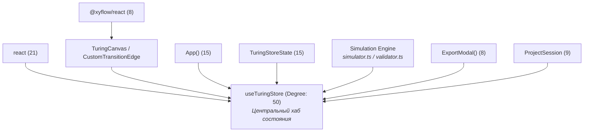
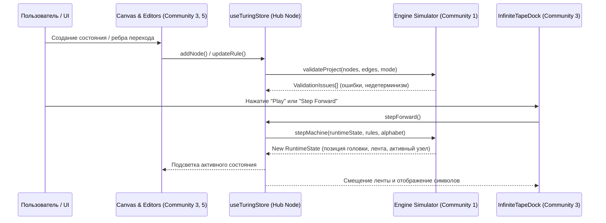

# Архитектурный граф знаний проекта (Graphify Knowledge Map)

Данный документ представляет собой структурную выжимку и архитектурный анализ графа знаний проекта **Next-Gen Turing Machine IDE & Diagrammer**, построенного с использованием движка `graphify`.

Граф построен на основе статического анализа исходного кода (`TypeScript / React / Zustand / @xyflow/react`), конфигурационных файлов и технической документации (`README.md`, `CHECKLIST_ROADMAP.md`).

---

## 1. Сводные метрики и артефакты графа

| Метрика | Значение | Описание |
| :--- | :--- | :--- |
| **Всего узлов (Nodes)** | **301** | Сущности системы: файлы, функции, типы, компоненты, разделы документации |
| **Всего связей (Edges)** | **604** | Вызовы функций, зависимости, импорты, ссылки, иерархия |
| **Сообществ / Кластеров (Communities)** | **12** | Автоматически выделенные функциональные подсистемы |
| **Циклических зависимостей (Import Cycles)** | **0** | В проекте отсутствуют циклические импорты |
| **Качество извлечения** | **100% EXTRACTED** | Полностью детерминированное извлечение из AST и структуры документов |

### Сгенерированные артефакты
* **Интерактивный граф (HTML-визуализация):** [`graphify-out/graph.html`](file:///home/dranik/Projects/laba/nojstd8/graphify-out/graph.html)  
  *Позволяет интерактивно исследовать узлы, фильтровать по сообществам, искать пути между концепциями и приближать кластеры.*
* **Машинночитаемый граф (JSON Graph):** [`graphify-out/graph.json`](file:///home/dranik/Projects/laba/nojstd8/graphify-out/graph.json)
* **Аналитический отчет:** [`graphify-out/GRAPH_REPORT.md`](file:///home/dranik/Projects/laba/nojstd8/graphify-out/GRAPH_REPORT.md)
* **Сырые экстракты и метаданные:** `graphify-out/.graphify_ast.json`, `graphify-out/.graphify_semantic.json`, `graphify-out/.graphify_analysis.json`

---

## 2. Архитектурные ядра ("God Nodes" — ключевые абстракции)

Узлы с максимальной связностью (degree centrality), представляющие собой основные центры притяжения логики:

| Ранг | Узел | Степень связности (Degree) | Расположение | Назначение в архитектуре |
| :---: | :--- | :---: | :--- | :--- |
| **1** | `useTuringStore` | **50** | `src/store/useTuringStore.ts` | **Главный оркестратор системы.** Центральное Zustand-хранилище, связывающее граф состояний, конфигурацию ленты, шаги симуляции, валидацию и историю undo/redo. |
| **2** | `react` | **21** | Зависимость npm | Базовый runtime интерфейса. |
| **3** | `lucide-react` | **19** | Зависимость npm | Библиотека векторных иконок для тулбаров, инспекторов и ленты. |
| **4** | `compilerOptions` | **16** | `tsconfig.json` | Корневая конфигурация компилятора TypeScript (strict mode, JSX, bundler). |
| **5** | `App()` | **15** | `src/App.tsx` | Корневой React-компонент: компоновка рабочей области, горячие клавиши, модальные окна. |
| **6** | `TuringStoreState` | **15** | `src/store/useTuringStore.ts` | Полный интерфейс состояния стора и всех доступных экшенов. |
| **7** | `5.2 Manual Testing Script & Route` | **14** | `CHECKLIST_ROADMAP.md` | Спецификация комплексных пользовательских сценариев сквозного тестирования. |
| **8** | `ProjectSession` | **9** | `src/types/turing.ts` | Модель сериализации проекта для локального сохранения, экспорта и шаринга. |
| **9** | `@xyflow/react` | **8** | Зависимость npm | Инфраструктура интерактивного бесконечного холста узлов и ребер. |
| **10** | `ExportModal()` | **8** | `src/components/navbar/ExportModal.tsx` | Модальное окно экспорта алгоритма (JSON, CSV таблица четверок/пятерок, PNG, SVG). |

---

## 3. Функциональная кластеризация (12 Сообществ)

Движок модульности Graphify разбил систему на 12 сообществ:

| ID | Название кластера | Узлов | Когезия | Ключевые файлы и символы |
| :---: | :--- | :---: | :---: | :--- |
| **0** | **Engine Unit Tests & Validation Cases** | 62 | 0.03 | `src/engine/engine.test.ts`, тесты детерминизма, симулятора, транслятора и циклов |
| **1** | **Simulation Engine & Execution Runtime** | 47 | 0.11 | `src/engine/simulator.ts`, `validator.ts`, `transpiler.ts`, `exporter.ts`, `RuntimeState`, `stepMachine()`, `initRuntimeState()` |
| **2** | **NPM Package Dependencies** | 43 | 0.06 | `package.json`, `zustand`, `@xyflow/react`, `immer`, `dagre`, `html-to-image` |
| **3** | **UI Shell & Canvas Components** | 41 | 0.14 | `src/App.tsx`, `TuringCanvas.tsx`, `OperationNode.tsx`, `MatrixEditor.tsx`, `TupleTableEditor.tsx`, `DiagnosticsPanel.tsx` |
| **4** | **Project Roadmap & Architecture Specs** | 27 | 0.07 | `CHECKLIST_ROADMAP.md` (спецификации диаграммера, ленты, отладчика и валидатора) |
| **5** | **Graph Flow & Transition Edges** | 23 | 0.12 | `CustomTransitionEdge.tsx`, `StateNode.tsx`, `RuleModal.tsx`, `NodeInspector.tsx`, `@xyflow/react` |
| **6** | **Testing Strategy & Acceptance Criteria** | 21 | 0.10 | `CHECKLIST_ROADMAP.md` (ручные тест-кейсы, критерии приемки, стратегия Vitest) |
| **7** | **TypeScript Build Configuration** | 18 | 0.11 | `tsconfig.json` (strict flags, moduleResolution, target) |
| **8** | **Core Features & Overview Documentation** | 11 | 0.18 | `README.md` (математические режимы классической машины и диаграмм Поста/ВТМ) |
| **9** | **Predefined Demo Turing Machines** | 5 | 0.40 | `src/store/demoProjects.ts` (`DEMO_PROJECT_1`, `DEMO_PROJECT_2`, `DEMO_PROJECT_3`, `INITIAL_PROJECTS`) |
| **10** | **Tailwind Styling Configuration** | 2 | 1.00 | `tailwind.config.js`, `tailwindcss` |
| **11** | **PostCSS Pipeline Config** | 1 | 1.00 | `postcss.config.js` |

---

## 4. Архитектурные мосты и кросс-компонентные связи

Анализ связей графа выявил важные паттерны взаимодействия подсистем:

### Поток данных и управления

### Специфические архитектурные находки (Surprising Connections)
1. **Прямое связывание компонентов ребер с хранилищем:**  
   Компоненты `CustomTransitionEdge`, `NodeInspector` и `RuleModal` напрямую вызывают селекторы и экшены из `useTuringStore`. Это обеспечивает мгновенное открытие модального окна редактирования правил прямо по клику на метку ребра в React Flow.
2. **Изоляция вычислительного ядра:**  
   Модуль `src/engine/` (`simulator.ts`, `validator.ts`, `transpiler.ts`, `exporter.ts`) **не имеет обратных зависимостей от React и UI-компонентов**. Он спроектирован как чистый функциональный вычислитель с чистыми TypeScript-типами, что обеспечивает высокую тестируемость (Cluster 0) и позволяет запускать симуляции в Headless/Batch режиме.
3. **Двусторонняя конвертация:**  
   В Community 1 функции `buildEdgesFromRules()` и `compileOperationalDiagramTo4Tuples()` обеспечивают взаимную трансляцию между классической 5-кортежной машиной Тьюринга и операционными диаграммами Поста/ВТМ (состояния-действия `L`, `R`, `Write`).

---

## 5. Выводы и рекомендации для Архитектора (Cartographer)

1. **Централизация состояния:**  
   `useTuringStore` является ключевой точкой схода для всех UI-компонентов (degree = 50). Рекомендуется активно использовать мелкие атомарные Zustand-селекторы (например, `const activeNodeId = useTuringStore(s => s.runtime.activeNodeId)`), чтобы избежать нежелательных ререндеров холста React Flow при обновлении ленты.
2. **Чистота зависимостей:**  
   Отсутствие циклических импортов подтверждает высокую культуру архитектуры проекта.
3. **Интерактивная карта:**  
   Для изучения взаимосвязей между узлами рекомендуется открыть файл `graphify-out/graph.html` в браузере.
