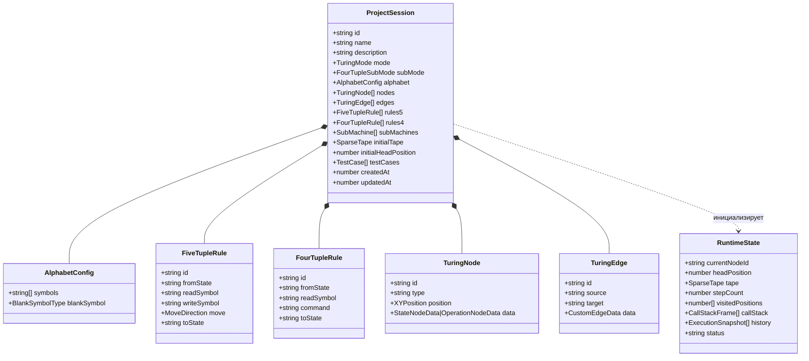
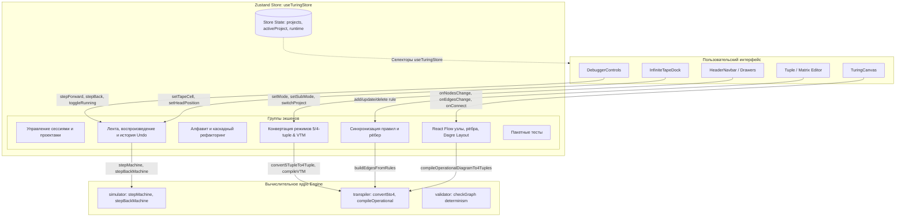
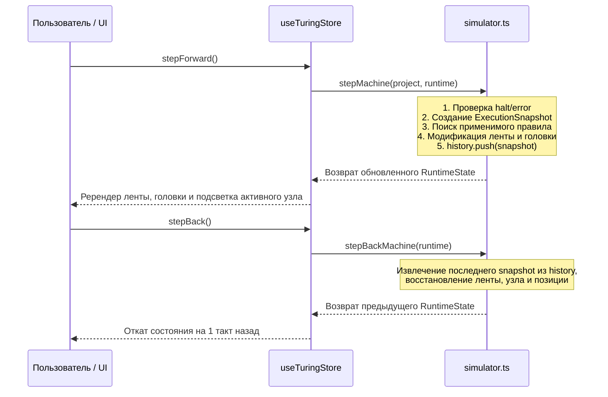

# Архитектурная карта: Модель состояния и система типов (State & Types)

Данный документ содержит детальный анализ архитектуры типов, централизованного хранилища Zustand, демонстрационных алгоритмов и точек входа интерактивного визуализатора Машины Тьюринга.

---

## 1. Точки входа приложения

### 1.1 `src/main.tsx`
Файл: [`src/main.tsx`](file:///home/dranik/Projects/laba/nojstd8/src/main.tsx)
- **Назначение**: Точка входа в React-приложение.
- **Инициализация**:
  - Использует `ReactDOM.createRoot` для монтирования в DOM-контейнер `#root`.
  - Оборачивает корневой компонент `<App />` в `<React.StrictMode>`.
  - Подключает глобальные стили Tailwind CSS через `import './index.css'`.

### 1.2 `src/App.tsx`
Файл: [`src/App.tsx`](file:///home/dranik/Projects/laba/nojstd8/src/App.tsx)
- **Назначение**: Главный каркасный компонент рабочего пространства (Shell / Workspace Layout).
- **Ключевые зоны интерфейса**:
  1. **Шапка (`HeaderNavbar`)**: Компактная панель (48px) с переключением режимов (5-tuple / 4-tuple), подрежимов (state-graph / operational), кнопками открытия менеджера сессий, редактора алфавита, экспорта и автолейаута.
  2. **Центральная рабочая область**:
     - **Холст (`TuringCanvas`)**: Интерактивная область React Flow для построения графов переходов и операционных схем VTM.
     - **Инспектор (боковая панель справа)**: Раскрывающаяся панель (384px–420px) с вкладками:
       * `tuples`: Табличный редактор четвёрок / пятёрок (`TupleTableEditor`).
       * `matrix`: Матрица переходов Состояния × Символы (`MatrixEditor`).
       * `check`: Панель диагностики и валидации детерминизма/полноты (`DiagnosticsPanel`).
       * `tests`: Пакетный запуск тестовых наборов (`BatchTestRunner`).
  3. **Подвал (Нижний док)**:
     - `InfiniteTapeDock`: Интерактивная бесконечная лента с визуализацией головки, подсветкой прочитанных и измененных ячеек.
     - `DebuggerControls`: Панель управления шагами, воспроизведением (Play/Pause), скоростью симуляции и сбросом.
  4. **Модальные окна и дроверы**:
     - `SessionManagerDrawer`: Список проектов, сохранение, импорт/экспорт JSON, создание копий.
     - `AlphabetBuilder`: Настройка внешнего и рабочего алфавитов, выбор пустого символа (Blank), каскадный рефакторинг символов.
     - `ExportModal`: Экспорт в LaTeX, Markdown, CSV, JSON, PNG, SVG.
- **Интеграция с хуками состояния**:
  - `useKeyboardShortcuts()`: Глобальные горячие клавиши симулятора (`Space` / `ArrowRight` — шаг вперед, `Shift+Space` / `ArrowLeft` — шаг назад, `R` — старт/пауза, `Esc` — сброс).
  - Эффект синхронизации темы: подписка на `theme` ('dark' | 'light') и добавление/удаление класса `dark` на корневом теге `document.documentElement`.

---

## 2. Полная модель данных TypeScript (`src/types/turing.ts`)

Файл: [`src/types/turing.ts`](file:///home/dranik/Projects/laba/nojstd8/src/types/turing.ts)

Система типов описывает математическую модель машины Тьюринга в двух парадигмах: классической (5-четвёрки/пятерки и 4-четвёрки Поста-Тьюринга) и операционной (VTM / Визуальная Машина Тьюринга).



### 2.1 Базовые перечисления и примитивы

| Тип | Определение / Значения | Назначение |
| :--- | :--- | :--- |
| `TuringMode` | `'5-tuple' \| '4-tuple'` | Классическая модель (одновременная запись и сдвиг) либо модель Поста (раздельная операция) |
| `FourTupleSubMode` | `'state-graph' \| 'operational'` | Представление 4-четвёрок: стандартный граф состояний либо операционная схема VTM |
| `MoveDirection` | `'L' \| 'R' \| 'N'` | Направление перемещения головки: Left, Right, None (на месте) |
| `BlankSymbolType` | `'λ' \| '_' \| '␣' \| 'a0'` | Маркер пустой ячейки бесконечной ленты |
| `StateNodeType` | `'initial' \| 'normal' \| 'halt' \| 'accept' \| 'reject'` | Роль вершины в графе состояний: стартовое, промежуточное, останов, допускающее, отвергающее |
| `OperationalNodeType` | `'START' \| 'FINISH' \| 'SHIFT_L' \| 'SHIFT_R' \| 'SEARCH_L' \| 'SEARCH_R' \| 'WRITE_SYM' \| 'COMPLEX_MACHINE'` | Тип макрокоманды в диаграммах VTM |
| `SparseTape` | `Record<number, string>` | Разреженная бесконечная лента: индекс ячейки $\mathbb{Z} \to$ символ. Неуказанные ячейки считаются равными `blankSymbol`. |

### 2.2 Структуры правил переходов

#### `FiveTupleRule` (Пятёрка)
Математический вид: $q_i, a \to b, D, q_j$ (где $D \in \{L, R, N\}$).
```typescript
export interface FiveTupleRule {
  id: string;
  fromState: string;     // Исходное состояние qi
  readSymbol: string;    // Считываемый с ленты символ
  writeSymbol: string;   // Записываемый символ
  move: MoveDirection;   // Сдвиг головки: 'L' | 'R' | 'N'
  toState: string;       // Новое состояние qj
}
```

#### `FourTupleRule` (Четвёрка)
Математический вид: $q_i, a \to C, q_j$, где $C$ — команда (запись символа `writeSymbol` ИЛИ движение `'L' | 'R' | 'N'`).
```typescript
export interface FourTupleRule {
  id: string;
  fromState: string;     // Исходное состояние qi
  readSymbol: string;    // Считываемый символ
  command: string;       // writeSymbol ИЛИ 'L' | 'R' | 'N'
  toState: string;       // Новое состояние qj
}
```

### 2.3 Модели узлов графа (React Flow Node Data)

Узел `TuringNode` типизирован как `Node<StateNodeData | OperationNodeData>`:

1. **`StateNodeData`** (Классический граф состояний):
   - `label: string` — имя состояния (напр. `"q0"`, `"q_add"`).
   - `stateType: StateNodeType` — семантика ('initial' | 'normal' | 'halt' | 'accept' | 'reject').
   - `description?: string` — комментарий к состоянию.
   - `isCurrent?: boolean` — флаг активного состояния при пошаговой симуляции.

2. **`OperationNodeData`** (Операционная диаграмма VTM):
   - `label: string` — отображаемое название узла (напр. `"SHIFT_R"`, `"[1]"`).
   - `opType: OperationalNodeType`:
     * `START`: Точка входа в алгоритм.
     * `FINISH`: Финальный терминальный узел.
     * `SHIFT_L` ($l$): Сдвиг на 1 ячейку влево.
     * `SHIFT_R` ($r$): Сдвиг на 1 ячейку вправо.
     * `SEARCH_L` ($L$): Сдвиг влево до обнаружения заданного символа / бланка.
     * `SEARCH_R` ($R$): Сдвиг вправо до бланка.
     * `WRITE_SYM` ($[a]$): Запись заданного символа на ленту.
     * `COMPLEX_MACHINE`: Вызов вложенной подмашины (поддерживает стек вызовов).
   - `symbolToWrite?: string` — записываемый символ (для `WRITE_SYM`).
   - `subMachineId?: string`, `subMachineName?: string` — ссылка на вызываемую подмашину.
   - `description?: string`, `isCurrent?: boolean`.

### 2.4 Модели рёбер и правил переходов (React Flow Edge Data)

- **`EdgeRuleItem`**: Правило, сгруппированное внутри ребра:
  ```typescript
  export interface EdgeRuleItem {
    id: string;
    readSymbol: string;
    // Для 5-tuple:
    writeSymbol?: string;
    move?: MoveDirection;
    // Для 4-tuple:
    command?: string;
    // Для VTM:
    isWildcard?: boolean;   // Переход по любому символу '*'
    isComplement?: boolean; // Отрицание символа '¬a'
  }
  ```
- **`CustomEdgeData`**:
  ```typescript
  export interface CustomEdgeData extends Record<string, unknown> {
    rules: EdgeRuleItem[];
    mode: TuringMode;
    subMode?: FourTupleSubMode;
    isBiDirectional?: boolean; // Дуга в обе стороны (для изогнутого рендера)
    offsetDirection?: 1 | -1;
    isActive?: boolean;        // Подсветка активного ребра во время выполнения
  }
  ```
- **`TuringEdge`**: Обертка `Edge<CustomEdgeData>`.

### 2.5 Тестирование и верификация (`TestCase`)

```typescript
export interface TestCase {
  id: string;
  name: string;
  inputTape: string;                   // Входная строка на ленте
  initialHeadPos?: number;             // Начальная позиция головки (по умолчанию 0)
  expectedTape?: string;               // Ожидаемый результат на ленте
  expectedHeadPos?: number;            // Ожидаемая финальная позиция
  expectedHalt?: 'accept' | 'reject' | 'any';
  lastActualTape?: string;             // Фактически полученная лента
  lastActualHeadPos?: number;
  lastStepsCount?: number;
  status?: 'idle' | 'passed' | 'failed' | 'error';
  errorMessage?: string;
}
```

### 2.6 Среда исполнения и история (`RuntimeState`, `ExecutionSnapshot`)

- **`ExecutionSnapshot`**: Слепок для поддержки Undo / Step Back:
  ```typescript
  export interface ExecutionSnapshot {
    currentNodeId: string;
    headPosition: number;
    tape: SparseTape;
    stepCount: number;
    visitedPositions: number[];
    callStack: CallStackFrame[];
  }
  ```
- **`RuntimeState`** (из `src/engine/simulator.ts`):
  Содержит полный мгновенный контекст симулятора, стек вызовов подмашин `callStack: CallStackFrame[]`, стек истории `history: ExecutionSnapshot[]` (ограничение до 500 шагов), статус (`idle` | `running` | `paused` | `halted` | `error`), а также идентификаторы активного узла, ребра и правила.

---

## 3. Структура Zustand Store (`src/store/useTuringStore.ts`)

Файл: [`src/store/useTuringStore.ts`](file:///home/dranik/Projects/laba/nojstd8/src/store/useTuringStore.ts)

Store построен на базе `zustand` с middleware `persist` и селективным сохранением в `localStorage` (с fallback-адаптером `safeStorage` в оперативную память при серверном окружении или отсутствии доступа к Storage).



### 3.1 Срез состояния (State Properties)

| Поле | Тип | Назначение | Сохраняется в Persist? |
| :--- | :--- | :--- | :---: |
| `projects` | `ProjectSession[]` | Все сохраненные сессии/проекты машин | **Да** |
| `activeProjectId` | `string` | Идентификатор текущего активного проекта | **Да** |
| `runtime` | `RuntimeState` | Активное вычислительное состояние (лента, головка, шаг, история) | Нет (вычисляется) |
| `theme` | `'light' \| 'dark'` | Цветовая тема интерфейса | **Да** |
| `activeTab` | `'tuples' \| 'matrix' \| 'check' \| 'tests'` | Активная вкладка правого инспектора | Нет |
| `selectedNodeId` | `string \| null` | Выделенный узел на холсте | Нет |
| `selectedEdgeId` | `string \| null` | Выделенное ребро на холсте | Нет |
| `isSessionDrawerOpen` | `boolean` | Открыта ли шторка управления проектами | Нет |
| `isAlphabetModalOpen` | `boolean` | Открыто ли окно настройки алфавита | Нет |
| `isExportModalOpen` | `boolean` | Открыто ли модальное окно экспорта | Нет |
| `isRuleModalOpen` | `boolean` | Открыто ли модальное окно редактирования правила перехода | Нет |
| `ruleModalData` | `{ edgeId?, sourceNodeId?, ... }` | Контекст связываемых узлов для создания правила | Нет |
| `executionSpeedMs` | `number` | Задержка между шагами при автозапуске (мс) | **Да** |
| `isRunning` | `boolean` | Флаг непрерывного воспроизведения симуляции | Нет |
| `keyboardShortcutsEnabled`| `boolean` | Включение/отключение глобальных горячих клавиш | **Да** |

### 3.2 Ключевые экшены и методы хранилища

#### А. Управление сессиями и проектами
- `getActiveProject(): ProjectSession` — возвращает активный объект проекта.
- `updateActiveProject(updater)` — иммутабельно обновляет текущий проект, проставляя `updatedAt: Date.now()`.
- `switchProject(id)` — переключает активный проект и переинициализирует `runtime = initRuntimeState(project)`.
- `createProject(mode, subMode, name)` — создает новый проект с дефолтными начальными узлами и лентой.
- `duplicateProject(id)` — глубокое клонирование проекта.
- `renameProject(id, name)` / `updateProjectDescription(id, desc)` — обновление метаданных.
- `deleteProject(id)` — удаление проекта (гарантирует сохранение как минимум 1 проекта в списке).
- `importProject(project)` — импорт готовой конфигурации из JSON.

#### Б. Смена режимов и трансляция
- `setMode(newMode: TuringMode)`:
  - При переходе `5-tuple` $\to$ `4-tuple`: вызывает `convert5TupleTo4Tuple(rules5)`, создает вспомогательные узлы состояний (auxiliary nodes `q_aux_*`) для разделения фазы записи и фазы сдвига, и строит новые рёбра `buildEdgesFromRules`.
  - При переходе `4-tuple` $\to$ `5-tuple`: вызывает `convert4TupleTo5Tuple(rules4)`, объединяя раздельные команды в единые 5-ки.
- `setSubMode(newSubMode: FourTupleSubMode, force = false)`:
  - При включении `'operational'`: компилирует граф VTM в четвёрки Поста с помощью `compileOperationalDiagramTo4Tuples`. Если проект пустой, разворачивает стандартный шаблон VTM (START $\to$ r $\to$ FINISH).
  - При переключении в `'state-graph'`: преобразует операционные узлы в состояния и строит рёбра переходов.

#### В. Алфавит и каскадный рефакторинг
- `setAlphabetSymbols(symbols: string[])` / `setBlankSymbol(blank: BlankSymbolType)`.
- `applyAlphabetPreset(presetKey)`: Поддержка встроенных пресетов (`binary`, `unary`, `decimal`, `hexadecimal`, `symbolic`).
- `refactorSymbol(oldSymbol: string, newSymbol: string)`:
  > **Каскадная модификация всей системы**:
  > Метод атомарно заменяет символ `oldSymbol` на `newSymbol` во всех структурах:
  > 1. В алфавите `alphabet.symbols` и `alphabet.blankSymbol`.
  > 2. В операционных узлах типа `WRITE_SYM` (поле `symbolToWrite`).
  > 3. В массивах правил `rules5` (`readSymbol`, `writeSymbol`) и `rules4` (`readSymbol`, `command`).
  > 4. В массиве ребер `edges` (вложенные `rules`).
  > 5. На ленте `initialTape` по всем занятым координатам.
  > 6. В тестовых наборах `testCases` (`inputTape` и `expectedTape`).
  > 7. Во всех вложенных подмашинах `subMachines`.
  > 8. Перезапускает `runtime` через `initRuntimeState`.

#### Г. Граф React Flow и визуальная синхронизация
- `onNodesChange`, `onEdgesChange`: Стандартные обработчики изменений геометрии и выделения React Flow. При удалении узлов автоматически удаляются инцидентные рёбра и связанные правила `rules5`/`rules4`.
- `onConnect(connection)`: Открывает `RuleModal` для создания правила перехода между двумя узлами.
- `addStateNode(type, label)` / `addOperationNode(opType, label, symbolToWrite)`: Добавление вершин с автоматической раскладкой координат по сетке.
- `applyAutoLayout()`: Автоматическая укладка графа с помощью библиотеки **Dagre** (алгоритм Sugiyama, выравнивание слева-направо 'LR').
- `deleteEdgeRule(edgeId, ruleId)`: Удаление конкретного правила из мульти-ребра с каскадной синхронизацией правил `rules5`/`rules4` и перекомпиляцией VTM.

#### Д. Управление лентой и средой исполнения
- `setTapeCell(pos, sym)`: Ручное редактирование отдельной ячейки ленты.
- `setTapeString(word, startPos)`: Запись слова целиком, начиная с заданной позиции.
- `setHeadPosition(pos)`: Перемещение каретки.
- `saveTapeToInitialBuffer()`: Сохранение текущей ленты как `initialTape` проекта.
- `resetTapeFromInitialBuffer()` / `resetExecution()`: Сброс исполнения на нулевой такт.
- `stepForward()`: Вызов `stepMachine(project, runtime)`.
- `stepBack()`: Вызов `stepBackMachine(runtime)` (откат на один снимок назад из `history`).
- `startRunning()`, `pauseRunning()`, `toggleRunning()`: Управление таймером воспроизведения.

#### Е. Тестирование и экспорт
- `runAllTestCases()` / `runSingleTestCase(id)`: Исполнение тестов в изолированном контексте `runTestCase(project, tc)` с записью реальной ленты, шагов и статуса.
- `exportDiagramImage(options)`: Экспорт холста в PNG / SVG через библиотеку `html-to-image`.

### 3.3 Вспомогательные хуки и утилиты

- `useActiveProject()`: Удобный селектор текущей активной сессии.
- `useRuntimeStats()` / `getRuntimeStats(project, runtime)`:
  Вычисляет статистику реального времени для панели отладки:
  - `stepCount`, `headPosition`, `currentSymbol`.
  - Минимальный и максимальный индексы ленты (`minTapeIndex`, `maxTapeIndex`), размах (`tapeSpan`).
  - Количество непустых ячеек (`nonBlankCellsCount`).
  - Метка и тип текущего узла (`currentNodeLabel`, `currentNodeType`).
  - Количество уникальных посещенных ячеек (`visitedPositionsCount`).
  - Глубина стека вызовов (`callStackDepth`).
- `handleDebuggerKeyboardShortcut(e, store)` / `useKeyboardShortcuts()`:
  Обработка нажатий клавиш:
  - Пропуск ввода, если фокус находится в `input`, `textarea` или `select`.
  - `Space` / `ArrowRight`: Шаг вперёд.
  - `Shift+Space` / `ArrowLeft`: Шаг назад.
  - `R`: Запуск / Пауза симулятора.
  - `Escape`: Полный сброс симулятора.

---

## 4. Предустановленные алгоритмы и демо-проекты (`src/store/demoProjects.ts`)

Файл: [`src/store/demoProjects.ts`](file:///home/dranik/Projects/laba/nojstd8/src/store/demoProjects.ts)

Файл содержит три эталонных проекта, покрывающих все поддерживаемые парадигмы машины Тьюринга.

### 4.1 Демо-проект 1: `DEMO_PROJECT_1` («Замена # и $ на нули»)
- **Идентификатор**: `demo-project-5tuple-replace`
- **Режим**: `5-tuple` (Классические пятёрки)
- **Алфавит**: Символы `['0', '1', '#', '$']`, пустой символ `'_'`.
- **Начальная лента**: `#10$1#$` на позициях 0..6, головка в позиции 0.
- **Архитектура автомата**:
  - Состояния:
    * `q0` (initial): Сканирует ячейку, выполняет замену служебных символов на `0` и сдвигается вправо (`R`).
    * `q_halt` (halt): Финальное состояние останова.
  - Таблица переходов:
    * $q_0, \# \to 0, R, q_0$
    * $q_0, \$ \to 0, R, q_0$
    * $q_0, 0 \to 0, R, q_0$
    * $q_0, 1 \to 1, R, q_0$
    * $q_0, \_ \to \_, N, q_{\text{halt}}$
- **Тестовые кейсы**:
  1. `Маркеры и цифры`: `#10$1#$` $\to$ `0100100` (позиция головки 7).
  2. `Только цифры`: `1010` $\to$ `1010` (позиция головки 4).
  3. `Только маркеры`: `##$$` $\to$ `0000` (позиция головки 4).

### 4.2 Демо-проект 2: `DEMO_PROJECT_2` («Инкремент двоичного числа»)
- **Идентификатор**: `demo-project-4tuple-increment`
- **Режим**: `4-tuple`, подрежим `state-graph` (Четвёрки Поста)
- **Алфавит**: Символы `['0', '1']`, пустой символ `'_'`.
- **Начальная лента**: `1011` (десятичное число 11).
- **Архитектура автомата**:
  Демонстрирует ключевую особенность четвёрок — **разделение фазы движения и фазы модификации ячейки**:
  1. `q_find_end`: Сдвиг вправо по цифрам `0` и `1` до встречи бланка `_`.
  2. `q_step_back`: При обнаружении бланка — шаг влево `L` на младший разряд числа и безусловный переход в `q_add`.
  3. `q_add`:
     * Если считан `0` или бланк `_`: записывает `1` и переходит в `q_halt` (перенос исчерпан).
     * Если считана `1`: записывает `0` (возник перенос в старший разряд) и переходит в `q_shift_left`.
  4. `q_shift_left`: Делает физический сдвиг влево `L` и возвращается в `q_add` для добавления бита переноса.
  5. `q_halt`: Терминальное состояние останова.
- **Тестовые кейсы**:
  1. `1011` (11) $\to$ `1100` (12).
  2. `111` (7) $\to$ `1000` (8) — тест на расширение разрядной сетки влево.
  3. `0` $\to$ `1`.

### 4.3 Демо-проект 3: `DEMO_PROJECT_3` («Копирование слова через # на VTM»)
- **Идентификатор**: `demo-project-vtm-copy`
- **Режим**: `4-tuple`, подрежим `operational` (Визуальная операционная диаграмма VTM)
- **Алфавит**: Символы `['0', '1', '#', '*']`, пустой символ `'_'`.
- **Начальная лента**: `1#` (исходное слово `1`, разделитель `#`).
- **Архитектура операционной диаграммы**:
  Узлами выступают макрокоманды машины, а рёбрами — условные переходы по считанному символу:
  ```mermaid
  flowchart LR
      START([START]) -->|*| Check["Проверка [a]<br/>(SHIFT_R)"]
      Check -->|1| Mark["Запись [*]<br/>(WRITE_SYM)"]
      Check -->|_ / # / *| FINISH([FINISH])
      Mark -->|*| SearchR["Поиск R (_)<br/>(SEARCH_R)"]
      SearchR -->|_| WriteCopy["Копия [1]<br/>(WRITE_SYM)"]
      WriteCopy -->|*| ReturnL["Поиск L (*)<br/>(SEARCH_L)"]
      ReturnL -->|*| Restore["Восст. [1]<br/>(WRITE_SYM)"]
      Restore -->|*| FINISH
  ```
  - `vtm_start` (START) $\xrightarrow{*}$ `vtm_check_char` (SHIFT_R).
  - Считывание единицы `1`: временная пометка символом `*` (`vtm_mark_x`).
  - Поиск правого свободного места `_` через `vtm_search_right` (SEARCH_R).
  - Запись скопированного символа `1` (`vtm_write_copy`).
  - Возврат влево к метке `*` через `vtm_return_left` (SEARCH_L).
  - Восстановление оригинального символа `1` (`vtm_restore_char`).
  - Завершение в узле `vtm_finish` (FINISH).

---

## 5. Взаимодействие Хранилища (Store) с UI и Вычислителем (Engine)

### 5.1 Схема двусторонней синхронизации (Two-Way Sync)

Одной из центральных задач архитектуры является бесшовная синхронизация между визуальным представлением графа (React Flow) и табличным представлением правил (Matrix / Tuples):

1. **Редактирование на холсте (Canvas $\to$ Store $\to$ Rules)**:
   - Пользователь соединяет два узла $\to$ срабатывает `onConnect`.
   - Открывается `RuleModal`, где задается считываемый и записываемый символ/направление.
   - Экшен `addFiveTupleRule` или `addFourTupleRule` добавляет правило в массив `rules5` / `rules4`.
   - Вспомогательная функция `buildEdgesFromRules` перестраивает массив рёбер `edges`, объединяя параллельные правила между одинаковыми парами узлов в единое ребро с меткой `EdgeRuleItem[]`.
2. **Редактирование в таблице или матрице (Inspector $\to$ Store $\to$ Canvas)**:
   - Пользователь изменяет ячейку в `MatrixEditor` или строку в `TupleTableEditor`.
   - Вызывается `updateFiveTupleRule` / `updateFourTupleRule`.
   - Store обновляет массив правил и повторно пересчитывает свойства `edges`.
   - Холст моментально отображает новые надписи на рёбрах без перезагрузки графа.
3. **Операционный режим VTM (VTM $\to$ 4-Tuples)**:
   - При любом изменении операционных узлов или связей вызывается транспайлер `compileOperationalDiagramTo4Tuples`.
   - Операционные узлы (`SEARCH_R`, `WRITE_SYM`, `SHIFT_L`) разворачиваются в детерминированные четвёрки Поста с синтезом служебных состояний.
   - Симулятор прозрачно выполняет скомпилированные четвёрки.

### 5.2 Пошаговая симуляция и откат (Step Forward & Step Back)



- **Ограничение истории**: Для предотвращения утечек оперативной памяти при длительных симуляциях массив `runtime.history` циклически ограничен 500 последними снимками (`nextHistory.shift()` при превышении длины).
- **Разреженная лента (`SparseTape`)**:
  - Использование объекта вида `{ [pos: number]: string }` позволяет эмулировать бесконечную в обе стороны ленту ($\mathbb{Z}$) без создания огромных массивов в памяти.
  - При чтении незаписанной ячейки симулятор автоматически возвращает `blankSymbol`.

---

## 6. Рекомендации для разработчиков

1. **Добавление нового типа узла**:
   - Расширить объединение `StateNodeType` или `OperationalNodeType` в [`src/types/turing.ts`](file:///home/dranik/Projects/laba/nojstd8/src/types/turing.ts).
   - Зарегистрировать отображение и стилизацию в [`src/components/canvas/StateNode.tsx`](file:///home/dranik/Projects/laba/nojstd8/src/components/canvas/StateNode.tsx) или [`OperationNode.tsx`](file:///home/dranik/Projects/laba/nojstd8/src/components/canvas/OperationNode.tsx).
   - Добавить обработку семантики исполнения в [`src/engine/simulator.ts`](file:///home/dranik/Projects/laba/nojstd8/src/engine/simulator.ts) (функция `stepMachine`).
2. **Добавление пресетов алфавитов**:
   - Добавить новый объект конфигурации в константу `ALPHABET_PRESETS` в [`src/store/useTuringStore.ts`](file:///home/dranik/Projects/laba/nojstd8/src/store/useTuringStore.ts).
3. **Безопасность состояния (Immutability)**:
   - Всегда использовать метод `updateActiveProject(updater)` для модификации данных активной сессии, чтобы гарантировать обновление метки времени `updatedAt` и корректное срабатывание селекторов Zustand.
